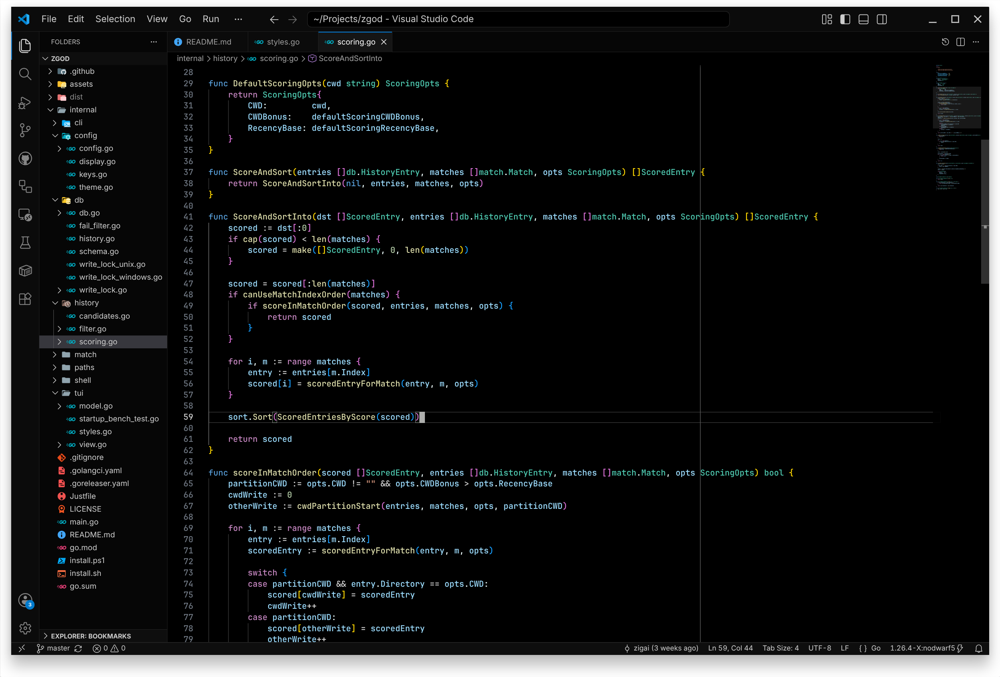

# Lumenweld

A near-black VS Code theme with quiet workbench surfaces and balanced syntax contrast.

## Previews

### Lumenweld


### Lumenweld Black



## Themes

| Theme             | Background | Use case                                                   |
| ----------------- | ---------- | ---------------------------------------------------------- |
| `Lumenweld`       | `#050505`  | Near-black UI while preserving visible panel separation.   |
| `Lumenweld Black` | `#000000`  | Fully black editor surface with deeper surrounding chrome. |

## Install

Install from a local VSIX:

```sh
npm install
npm run package
code --install-extension dist/lumenweld.vsix
```

Then open the color theme picker with `Preferences: Color Theme` and select
`Lumenweld` or `Lumenweld Black`.

## Development

Install dependencies:

```sh
npm install
```

Run the checks:

```sh
npm run check
```

Open this repository in VS Code and press `F5` to launch an Extension
Development Host with the theme loaded.

## License

[MIT](LICENSE)
