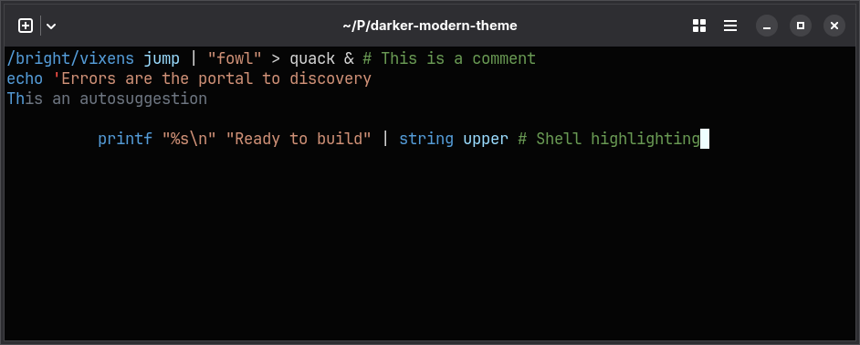
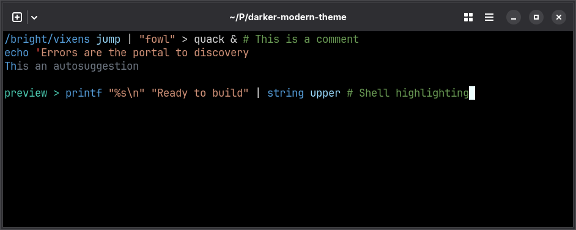

# Darker Modern for Fish

A darker evolution of VS Code’s Dark Modern

| Darker Modern                                                        | Darker Modern Black                                                              |
| -------------------------------------------------------------------- | -------------------------------------------------------------------------------- |
|  |  |

Screenshots use the matching [Ghostty theme](../ghostty/README.md) for terminal colors.

## Installation

```sh
mkdir -p ~/.config/fish/themes
cp themes/fish/darker-modern.theme themes/fish/darker-modern-black.theme ~/.config/fish/themes/
```

Run from the repository root. Use your Fish configuration directory if it differs from `~/.config/fish`.

## Quick start

Run in Fish to apply the theme to the current shell:

```fish
fish_config theme choose darker-modern
```

Add the same command to `~/.config/fish/config.fish` to load it in new shells. Use `darker-modern-black` for the black variant.

## License

[MIT](../../LICENSE)
