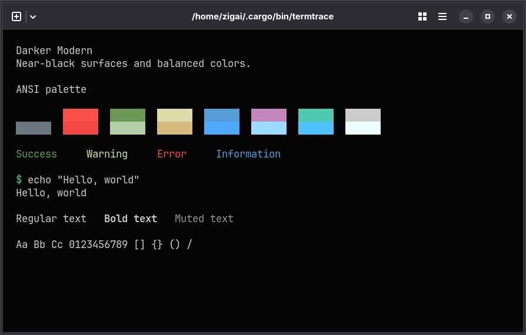
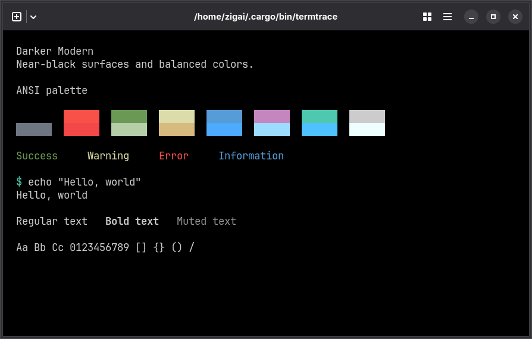

# Darker Modern for Ghostty

A darker evolution of VS Code’s Dark Modern

| Darker Modern                                              | Darker Modern Black                                                    |
| ---------------------------------------------------------- | ---------------------------------------------------------------------- |
|  |  |

## Installation

```sh
mkdir -p ~/.config/ghostty/themes
cp themes/ghostty/darker-modern themes/ghostty/darker-modern-black ~/.config/ghostty/themes/
```

Run from the repository root. If you use `XDG_CONFIG_HOME`, copy into its `ghostty/themes` directory instead.

## Quick start

Set in your Ghostty configuration:

```ini
theme = darker-modern
```

Use `darker-modern-black` for the black variant, then reload the configuration. Explicit color settings in your configuration override theme colors.

## License

[MIT](../../LICENSE)
