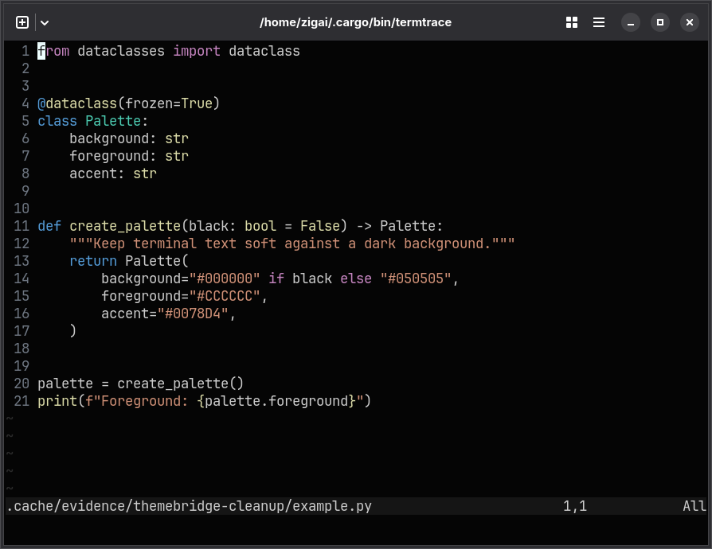
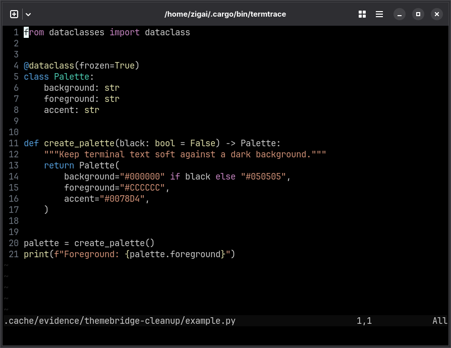

# Darker Modern for Neovim

Near-black editor backgrounds and balanced syntax colors, with a fully black variant.

| Darker Modern                                             | Darker Modern Black                                                   |
| --------------------------------------------------------- | --------------------------------------------------------------------- |
|  |  |

## Installation

```sh
mkdir -p ~/.config/nvim/colors
cp themes/nvim/darker-modern.lua themes/nvim/darker-modern-black.lua ~/.config/nvim/colors/
```

Run from the repository root. Use your Neovim configuration directory if it differs from `~/.config/nvim`.

## Quick start

Add to `init.lua`:

```lua
vim.opt.termguicolors = true
vim.cmd.colorscheme("darker-modern")
```

Use `darker-modern-black` for the black variant.

## License

[MIT](../../LICENSE)
