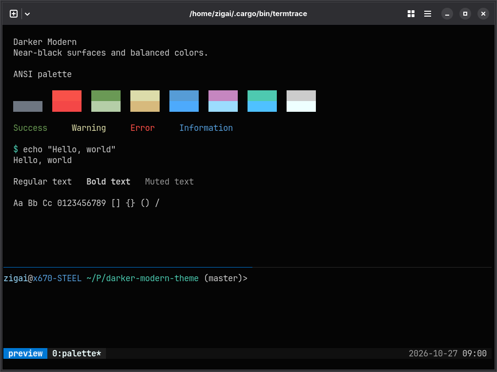
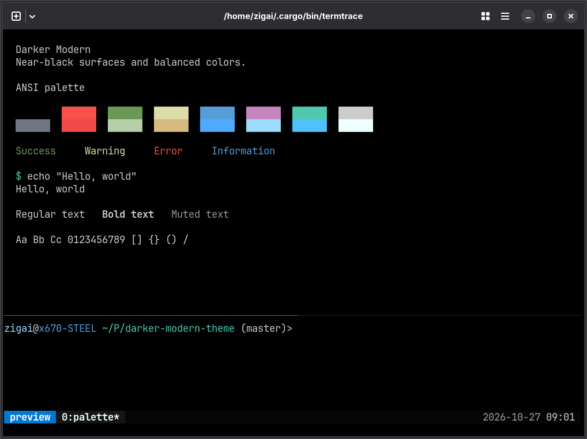

# Darker Modern for tmux

A darker evolution of VS Code’s Dark Modern

| Darker Modern                                           | Darker Modern Black                                                 |
| ------------------------------------------------------- | ------------------------------------------------------------------- |
|  |  |

Screenshots use the matching [Ghostty theme](../ghostty/README.md) for terminal colors.

## Installation

```sh
mkdir -p ~/.config/tmux/themes
cp themes/tmux/darker-modern.conf themes/tmux/darker-modern-black.conf ~/.config/tmux/themes/
```

Run from the repository root. Verified with stock tmux 3.6.

## Quick start

Add to `~/.tmux.conf`:

```tmux
source-file ~/.config/tmux/themes/darker-modern.conf
```

Use `darker-modern-black.conf` for the black variant. Reload with `tmux source-file ~/.tmux.conf`.

## License

[MIT](../../LICENSE)
