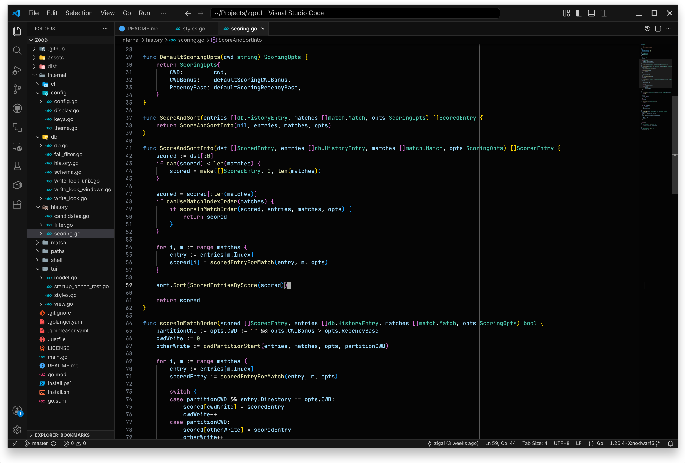

# Darker Modern for VS Code

A darker evolution of VS Code’s Dark Modern

| Darker Modern                                              | Darker Modern Black                                                    |
| ---------------------------------------------------------- | ---------------------------------------------------------------------- |
|  |  |

## Installation

```sh
npm ci --prefix themes/vscode
npm --prefix themes/vscode run package
code --install-extension themes/vscode/dist/darker-modern.vsix
```

Run from the repository root. Requires Node.js 20 or newer and VS Code 1.84 or newer.

## Quick start

Open **Preferences: Color Theme** and select **Darker Modern** or **Darker Modern Black**.

For extension development, open the repository in VS Code and press `F5`. The launch configuration loads `themes/vscode` as the extension root.

## License

[MIT](LICENSE)
