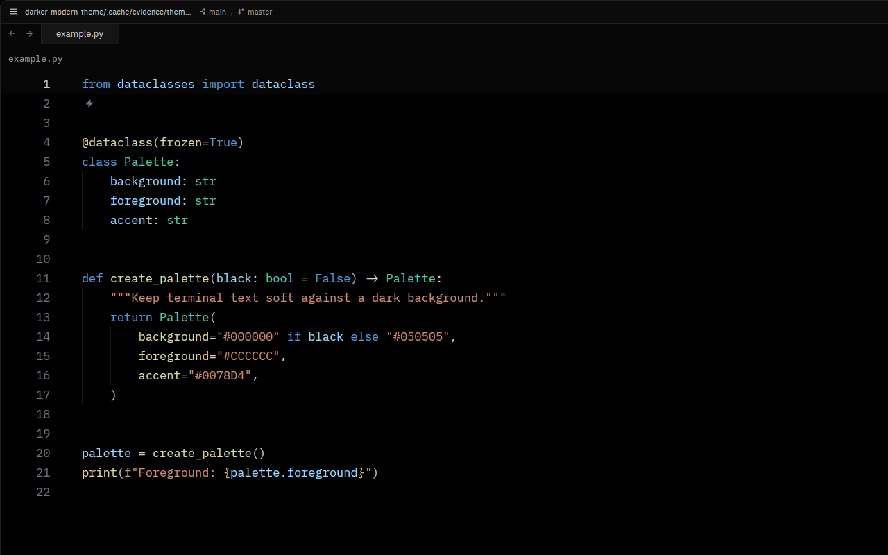

# Darker Modern for Zed

A darker evolution of VS Code’s Dark Modern

| Darker Modern                                          | Darker Modern Black                                                |
| ------------------------------------------------------ | ------------------------------------------------------------------ |
|  |  |

## Installation

```sh
mkdir -p ~/.config/zed/themes
cp themes/zed/darker-modern.json ~/.config/zed/themes/
```

Run from the repository root. Use your Zed configuration directory if it differs from `~/.config/zed`.

## Quick start

Open **theme selector: toggle** from the command palette and select **Darker Modern** or **Darker Modern Black**.

The choice is saved in `settings.json`:

```json
{
    "theme": "Darker Modern"
}
```

## License

[MIT](../../LICENSE)
