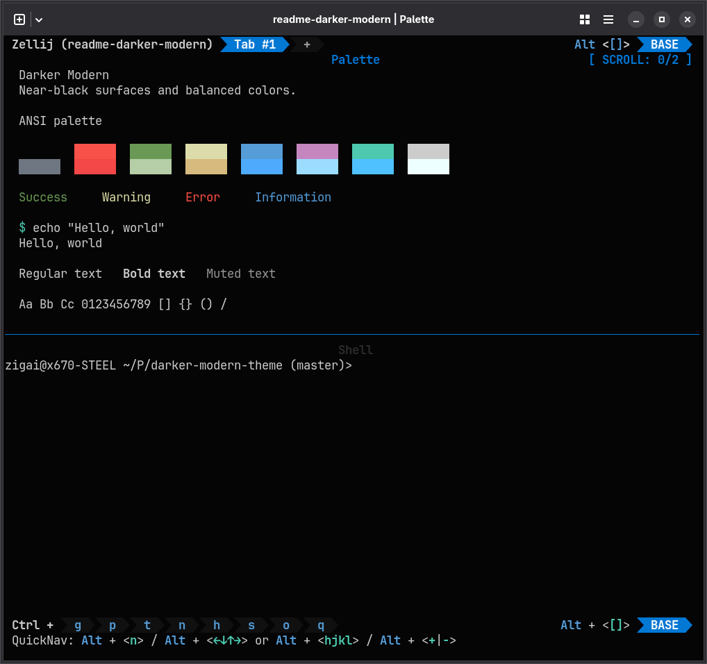
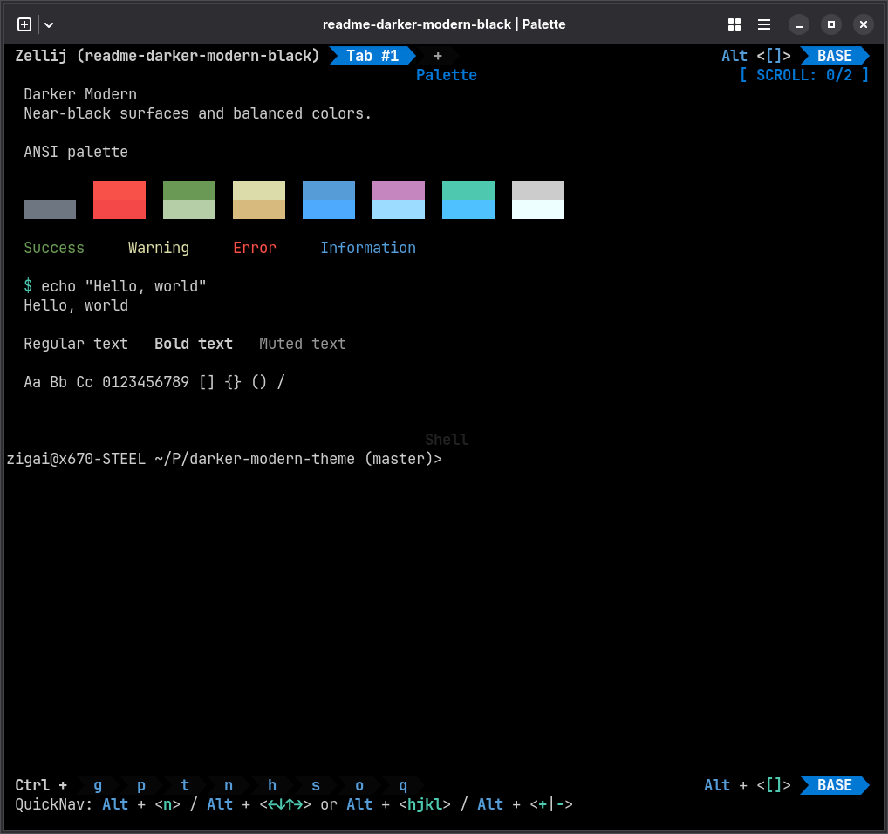

# Darker Modern for Zellij

A darker evolution of VS Code’s Dark Modern

| Darker Modern                                             | Darker Modern Black                                                   |
| --------------------------------------------------------- | --------------------------------------------------------------------- |
|  |  |

Screenshots use the matching [Ghostty theme](../ghostty/README.md) for terminal colors.

## Installation

```sh
mkdir -p ~/.config/zellij/themes
cp themes/zellij/darker-modern.kdl themes/zellij/darker-modern-black.kdl ~/.config/zellij/themes/
```

Run from the repository root. Use the theme directory reported by `zellij setup --check` if it differs from `~/.config/zellij/themes`.

## Quick start

Set in `config.kdl`:

```kdl
theme "darker-modern"
```

Use `darker-modern-black` for the black variant. To try it for one session, run `zellij options --theme darker-modern`.

## License

[MIT](../../LICENSE)
